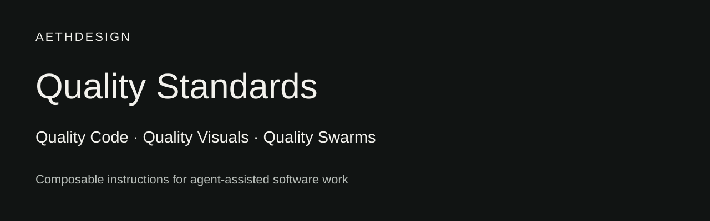

# Quality Code / Making quality inspectable

**AethDesign · Open engineering · Quality Code standard v3**

[Open the branded reader edition →](https://aethirex-ai.github.io/quality-code/)

The audit findings below describe the initial standard v2 public edition. Standard v3 adds provider-neutral delegation; it does not change that historical evidence.

## The problem

A coding agent can complete a task without sharing the project’s definition of “done.” Architecture context may be scattered, a passing build may be mistaken for behavioral evidence, and every change may receive either too little review or excessive ceremony.

AethDesign’s bootstrap addresses that ambiguity before implementation begins. This public edition packages the existing local Python engine, project templates, and audit instructions with documentation and reproducible tests.

## The design

**One shared workflow.** `AGENTS.md` holds the project instructions. `CLAUDE.md` imports them, so the two entry points refer to the same quality contract.

**A compact map.** `MAP.md` records boundaries, contracts, ownership, and invariants. Path routes select relevant sections instead of requiring the agent to load an entire inventory.

**Proportionate verification.** Four risk lanes connect product impact to evidence. Isolated copy receives a focused confirmation; persistence and security changes require stronger testing and independent scrutiny.

**An independent second layer.** Higher-risk work produces a compact audit handoff. A fresh auditor reproduces checks and returns a structured verdict while leaving the worktree unchanged.

**Preservation during adoption.** The bootstrap merges instructions, adds missing document sections, refuses an unrelated wrapper collision, and reuses an existing parent Git boundary.

## A concrete workflow

Consider a change to `src/auth/session.py` in a project with the default security route:

1. Write criteria: expired sessions are rejected, valid sessions remain accepted, and rejection does not mutate stored state.
2. Inspect `Contracts and state`, `Security, privacy, and safety`, and `Change invariants` in the map.
3. Route the path as critical; add focused positive, negative, and boundary tests.
4. Run full and release verification, then generate the packet with an explicit Git base.
5. Give the packet and raw scope to a fresh auditor. Missing required platform evidence produces `BLOCKED`; a reproducible failure produces `FAIL`.

This is an illustrative workflow, not a report of a production authentication migration.

## Evidence readers can inspect

| Design claim | Repository evidence |
| --- | --- |
| Existing content survives adoption | Bootstrap integration tests in `tests/test_quality.py` |
| Higher-risk routes win | Routing and audit-packet regression tests |
| Verification failures remain visible | Failed-command and invalid-profile tests |
| Installation has a bounded distribution | Isolated-home installer test |
| Review has an explicit independence contract | `SKILL.md` and `references/AUDIT_PROTOCOL.md` |

Run `./quality verify full` to reproduce the toolkit checks locally. Hosted CI results become evidence only when the published workflow runs successfully.

## What independent review changed

The initial public-edition audit reproduced failures beyond the original tests. Preparing this repository therefore improved the toolkit itself:

| Finding | Correction and retained regression |
| --- | --- |
| Adoption could overwrite unrelated `.quality/` runtime files | Preflight runtime, schema, and license collisions before project writes |
| A child project’s tracked diff could include sibling changes and incorrect path prefixes | Confine Git scope to the project and emit project-relative paths |
| A specific route for one file could hide fallback risk for a different file | Resolve effective routes per file, then select the highest risk across the change |
| Installed and generated copies omitted the license notice | Include LICENSE in installed distributions and generated project tooling |

The independent re-audit returned `PASS` with no findings after reproducing the corrections and running all 19 tests. Hosted CI remains separately inspectable in GitHub Actions.

These are observed toolkit defects and concrete corrections, not claims about defect reduction in client projects. The regression suite preserves the reproductions so future changes can be checked against them.

## What this demonstrates—and what remains open

The repository demonstrates an implemented workflow, executable checks, preservation behavior, and explicit review requirements. It does not demonstrate measured changes in production defect rates, delivery speed, or customer outcomes. An exploratory three-page delegation pilot now records solver time, coding-session usage, image counts, functional checks and an anonymous visual review; it does not establish production or general efficiency gains.

Agent compliance, project-specific test quality, live providers, Windows shell behavior, and production deployment controls remain outside the toolkit’s guarantees. The follow-up below separately measures concrete error discovery and repair on frozen synthetic contracts. Production escaped-defect rates and larger repository investigations remain unmeasured.

## A measured delegation pilot

In one paired fictional-business workload, a bounded swarm finished in **9m 19s**, compared with **15m 52s** for a single agent. Both passed 58/58 identical browser checks. The swarm used more coding tokens and had a higher hypothetical Standard API coding subtotal: **$1.0374 versus $0.7188**, excluding image-generation and other tool charges. One anonymous reviewer rated the single agent higher visually, **4.33/5 versus 4.10/5**. Six native images were generated per subject, without retries.

That is an observed trade-off from one run, not evidence of subscription savings or a general advantage. [Read the protocol, complete accounting, review and limitations](../benchmarks/landing-pages-2026-10/RESULTS.md), or [inspect all six fictional landing pages](benchmarks/landing-pages-2026-10/index.html). Raw provider logs and private paths are excluded.

## Diagnosing the overhead, then testing again

The first swarm's descendants added 1,488,749 input tokens while its primary saved 242,116, leaving 1,246,633 more input tokens overall. Native runtime context repeated full project and global delegation instructions; the hierarchy also repeated inspections and small interaction checks. The inexpensive nested helper cost only $0.0078 in the coding estimate. The lower visual rating centered on mobile pacing, crowded fields and image/content fit; these observations do not prove the hierarchy caused them.

We revised the provider-neutral policy to favor coherent direct owners, the smallest useful team, one budget across descendants, scoped fresh context and milestone-based coordination. Global instructions now route to the supplied project policy instead of repeating it. Visual acceptance explicitly includes mobile composition and image/content fit. These instructions were delivered to 12 working project roots while preserving project configuration and custom guidance.

The next pair uses three different client types and styles: an editorial boutique hotel, a bold fitness studio and a Swiss editorial landscape practice. A separate pair reviews JavaScript client helpers with explicit contracts, hidden defect checks and healthy controls. Timed outputs remain frozen before grading. Changing both policy and workload prevents attributing cross-pilot differences to the policy alone.

The new adaptive portfolio finished 37.6% sooner and received a higher anonymous visual mean (4.13/5 versus 3.80/5), while its coding API equivalent was 52.9% higher. In the separate defect review, both found and repaired eight seeded causes; adaptive also fixed one verified additional date-type defect. That review was 9.1% slower and 6.2% higher in coding API equivalent. These are workload observations, not a general benefit or subscription savings claim.

[Read the follow-up results and error-finding evidence](../benchmarks/client-pilot-round2-2026-10/RESULTS.md), or [inspect the new fictional portfolio concepts](benchmarks/client-pilot-round2-2026-10/index.html).

## The AethDesign connection

Quality Code makes one part of AethDesign’s engineering process public: how we ask coding agents to understand a project, prove a change, and surface uncertainty. Readers can reuse the system, challenge its choices, or bring the same discipline to a project with us.

[Explore AethDesign →](https://www.aethdesign.com/?utm_source=github&utm_medium=case_study&utm_campaign=quality-code)
